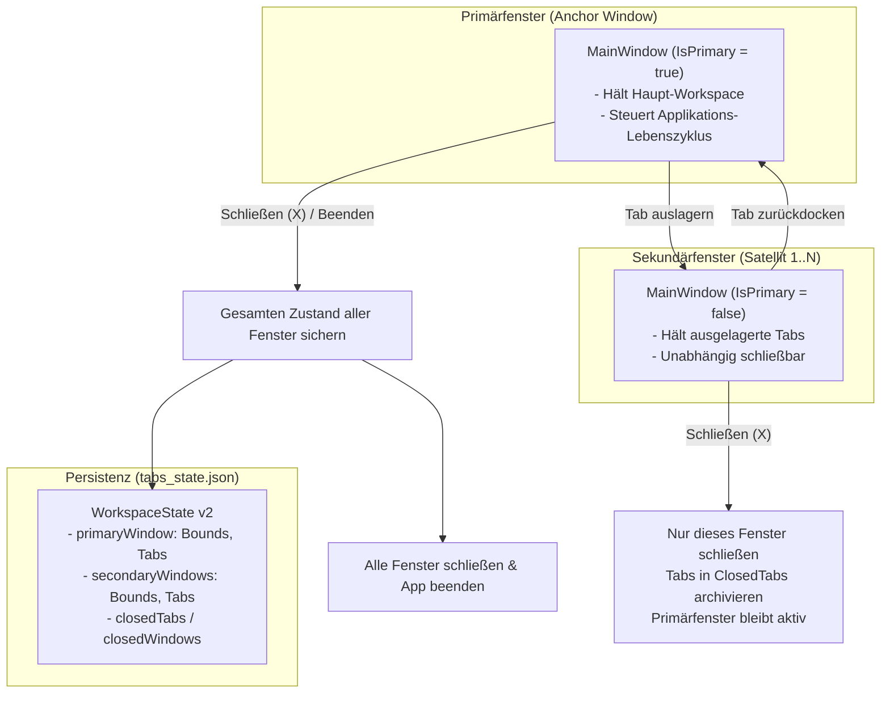

# Feature Specification: `FEAT-TAB-026` (Multi-Window Undocking & Redocking)

> **Requirement ID**: [`[REQ-TAB-026]`](../requirements/modules/presentation.md#req-tab-026-detachable-window-undocking--redocking-for-multi-monitor-workflows)  
> **Module**: `Presentation & Window Management` (`TAB` / `UI`)  
> **Target Release**: `v1.3.0`  
> **Status**: `APPROVED`  
> **Architecture Reference**: [`docs/architecture/modules/presentation.md`](../architecture/modules/presentation.md)  
> **Governance Standard**: [`AGENTS.md`](../../AGENTS.md)

---

## 1. Overview & Problem Statement

In modern software development and operations workflows, multi-monitor setups are the industry standard. Users frequently need to detach specific terminal sessions (such as long-running build processes, server logs, Docker monitors, or REPL sessions) to a secondary screen while keeping their primary shell workflow uninterrupted.

Previously, MultiShell supported multiple split panes within a single window, but tabs could not be dragged out into separate desktop windows. Furthermore, in multi-window applications, naive persistence implementations often lead to the catastrophic **"Last-Window-Exit" data loss bug**, where closing an auxiliary single-tab window overwrites the state of a previously closed multi-tab primary window.

`FEAT-TAB-026` solves this with a robust **Primary-Anchor Multi-Window Model**:
1. Users can detach tabs into independent peer windows via Drag & Drop or keyboard shortcuts (`Ctrl+Shift+U`).
2. ConPTY shell sessions transition smoothly across windows with **Zero Process Interruption** (no PTY restarts, no dropped output).
3. The **Primary Window** anchors the workspace: closing the primary window saves the entire multi-monitor workspace and cleanly closes all windows, restoring the full multi-window layout upon next startup.
4. **Secondary Windows** can be closed independently without affecting the primary workspace.

---

## 2. Window Roles & Lifecycle Behavior



### 2.1 Primärfenster (Primary Window)
- **Rolle**: Der Master-Anker der Arbeitssitzung.
- **Initialisierung**: Das beim Start von MultiShell geöffnete Hauptfenster erhält automatisch die Rolle `IsPrimary = true`.
- **Schließverhalten**:
  - Ein Klick auf das rote Schließen-Kreuz (`✕`) oder `Alt+F4` im Primärfenster beendet die **gesamte MultiShell-Sitzung**.
  - Vor dem Beenden wird ein atomarer Snapshot aller offenen Fenster (Primär- und aller Sekundärfenster mit ihren jeweiligen Positionen, Dimensionen und Tabs) in `tabs_state.json` geschrieben.
  - Alle Sekundärfenster werden sauber geschlossen, und alle PTY-Prozesse werden geordnet heruntergefahren.

### 2.2 Sekundärfenster (Secondary / Satellite Windows)
- **Rolle**: Eigenständige Auslagerungsfenster für spezifische Monitore oder Teilaufgaben.
- **Initialisierung**: Jedes durch Tab-Abdocken neu erzeugte Fenster erhält `IsPrimary = false`.
- **Schließverhalten**:
  - Ein Klick auf das Schließen-Kreuz (`✕`) im Sekundärfenster schließt **ausschließlich dieses Fenster**.
  - Das Primärfenster und alle anderen Sekundärfenster laufen ungestört weiter.
  - Die geschlossenen Tabs des Sekundärfensters werden in die `ClosedTabs`-Historie verschoben (wiederherstellbar via `Ctrl+Shift+T`).

### 2.3 Rollen-Beförderung (Promotion to Primary)
- Möchte der Benutzer sein Hauptarbeitsfenster auf einen anderen Monitor verlegen, kann ein Sekundärfenster über das Fenster-Menü oder Rechtsklick auf den Header zu `Als Hauptfenster festlegen` befördert werden. Das bisherige Primärfenster wird dabei transparent zum Sekundärfenster degradiert.

---

## 3. Visuelle & Ergonomische Unterscheidung

Um Verwechslungen auszuschließen, unterscheiden sich Primär- und Sekundärfenster optisch und in ihren Interaktionselementen:

| Element | Primärfenster (Hauptfenster) | Sekundärfenster (Ausgelagert) |
| :--- | :--- | :--- |
| **Titelzeile / Header** | `MultiShell` (App-Logo) | `MultiShell` + Badge `[Fenster 2 ⧉]` |
| **Schließen-Button (`✕`) Tooltip** | *„MultiShell beenden (alle Fenster sichern & schließen)“* | *„Dieses Fenster schließen“* |
| **Dock-Back Button** | *(nicht vorhanden)* | Button **`[ ⇲ Zurück ins Hauptfenster ]`** neben Fenster-Controls |
| **Tab-Kontextmenü** | `Tab in neuem Fenster öffnen` (`Ctrl+Shift+U`) | `Tab ins Hauptfenster verschieben` (`Ctrl+Shift+U`) |
| **Global Overlay (`Ctrl+Shift+H`)** | Zeigt globale Aktionen & alle Tabs | Zeigt Aktionen bezogen auf das aktuelle Fenster |

---

## 4. Acceptance Criteria (Given-When-Then)

### `[AC-1]` Tab Undocking via Drag & Drop
- **Given** ein geöffneter Tab in einem beliebigen MultiShell-Fenster,
- **When** der Benutzer den Tab-Header mit gedrückter linker Maustaste über die Grenzen des aktuellen Fensters hinaus auf den Desktop oder einen zweiten Monitor zieht und loslässt,
- **Then** wird an der Zeigerposition ein neues sekundäres `MainWindow` erstellt, das den Tab aufnimmt,
- **And** die laufende Shell-Sitzung (ConPTY) läuft ohne Neustart oder Unterbrechung im neuen Fenster weiter.

### `[AC-2]` Tab Undocking via Context Menu & Keyboard Shortcut
- **Given** ein aktiver Tab im Primär- oder Sekundärfenster,
- **When** der Benutzer `Ctrl+Shift+U` drückt oder im Tab-Kontextmenü `Tab in neuem Fenster öffnen` auswählt,
- **Then** wird der Tab sofort in ein neues Sekundärfenster auf demselben oder dem benachbarten Monitor ausgelagert.

### `[AC-3]` Cross-Window Redocking via Drag & Drop
- **Given** ein Tab in einem Sekundärfenster,
- **When** der Benutzer den Tab-Header auf die Tab-Leiste des Primärfensters (oder eines anderen Sekundärfensters) zieht,
- **Then** integriert sich der Tab an der Drop-Position nahtlos in die Ziel-Tab-Leiste,
- **And** schließt sich das Quellfenster automatisch, falls es sein letzter verbleibender Tab war.

### `[AC-4]` 1-Klick Redocking („Zurück ins Hauptfenster“)
- **Given** ein geöffnetes Sekundärfenster,
- **When** der Benutzer auf die Header-Schaltfläche `[ ⇲ Zurück ins Hauptfenster ]` klickt,
- **Then** werden alle Tabs des Sekundärfensters in das Primärfenster überführt und das Sekundärfenster schließt sich.

### `[AC-5]` Schließen des Primärfensters (Globaler Snapshot & Exit)
- **Given** das Primärfenster und ein oder mehrere Sekundärfenster sind geöffnet,
- **When** der Benutzer das Primärfenster über `✕`, `Alt+F4` oder das Menü schließt,
- **Then** sammelt der `WindowCoordinatorService` alle Fenster-Koordinaten, Monitor-Indizes, Fenstergrößen und Tab-Zustände ein,
- **And** schreibt den vollständigen Multi-Window-Zustand atomar in `tabs_state.json`,
- **And** schließt alle Sekundärfenster ohne verwaiste ConPTY-Handles und beendet die Anwendung sauber.

### `[AC-6]` Schließen eines Sekundärfensters (Isolierter Close)
- **Given** das Primärfenster und mindestens ein Sekundärfenster sind geöffnet,
- **When** der Benutzer ein Sekundärfenster über `✕` schließt,
- **Then** schließt sich nur dieses spezifische Sekundärfenster,
- **And** die Tabs dieses Fensters werden in die `ClosedTabs`-Historie überführt,
- **And** das Primärfenster und alle anderen Fenster laufen ohne Unterbrechung weiter.

### `[AC-7]` Vollständige Multi-Window-Wiederherstellung beim Neustart
- **Given** eine MultiShell-Sitzung wurde durch Schließen des Primärfensters mit mehreren Fenstern beendet,
- **When** MultiShell neu gestartet wird,
- **Then** öffnet sich das Primärfenster an seinen vorherigen Koordinaten mit seinen Tabs,
- **And** jedes zuvor geöffnete Sekundärfenster öffnet sich automatisch auf dem jeweiligen Monitor mit seinen Tabs und Pfaden.

---

## 5. Komponenten & Schnittstellen-Design

```
Services/
├── IWindowCoordinatorService.cs       # Zentrale Koordination aller Anwendungsfenster
└── WindowCoordinatorService.cs        # Multi-Window Lifecycle, Cross-Window Transfers & Persistenz

ViewModels/
├── MainViewModel.cs                   # Erhält WindowRole (Primary vs. Secondary)
├── MainViewModel.MultiWindow.cs       # Detach-, Redock- und Promotion-Commands
└── TerminalTabViewModel.cs            # Bleibt fensteragnostisch (PTY-Continuity)

Views/
├── MainWindow.axaml                   # Header-Badge [Fenster N], Dock-Back-Button, Close-Tooltips
├── MainWindow.Tabs.cs                 # Drag-out Threshold-Erkennung
└── MainWindow.CrossWindowDrop.cs      # Avalonia DragDrop Cross-Window Empfangslogik
```

### 5.1 Service-Vertrag: `IWindowCoordinatorService`

```csharp
namespace MultiShell.Services;

public interface IWindowCoordinatorService
{
    MainWindow PrimaryWindow { get; }
    IReadOnlyList<MainWindow> ActiveWindows { get; }
    
    void RegisterWindow(MainWindow window, MainViewModel viewModel, bool isPrimary = false);
    void UnregisterWindow(MainWindow window);
    
    MainWindow DetachTabToNewWindow(TerminalTabViewModel tab, PixelPoint screenPosition, Size initialSize);
    void TransferTab(TerminalTabViewModel tab, MainViewModel sourceVm, MainViewModel targetVm, int targetIndex = -1);
    void MergeSecondaryWindowIntoPrimary(MainWindow secondaryWindow);
    void SetPrimaryWindow(MainWindow window);
    
    Task SaveAllWindowStatesAsync(CancellationToken cancellationToken = default);
    Task RestoreAllWindowsAsync(CancellationToken cancellationToken = default);
}
```

---

## 6. Persistenz-Schema (`tabs_state.json` Version 2)

```json
{
  "$schema": "https://raw.githubusercontent.com/histore/multishell/main/schemas/tabs_state.v2.json",
  "version": 2,
  "savedLanguage": "de",
  "appFontSizeLevel": 4,
  "terminalFontSizeLevel": 4,
  "defaultShellType": "PowerShell",
  "isDarkAppTheme": true,
  "isDarkTerminalTheme": true,
  "primaryWindow": {
    "bounds": { "x": 100, "y": 80, "width": 1400, "height": 900 },
    "isMaximized": true,
    "selectedTabIndex": 0,
    "tabs": [
      {
        "title": "pwsh - C:\\projekte\\csharp\\multishell",
        "workingDirectory": "C:\\projekte\\csharp\\multishell",
        "shellType": "PowerShell"
      }
    ]
  },
  "secondaryWindows": [
    {
      "id": "win-secondary-1",
      "displayName": "Fenster 2",
      "bounds": { "x": 1920, "y": 100, "width": 1200, "height": 800 },
      "isMaximized": false,
      "selectedTabIndex": 0,
      "tabs": [
        {
          "title": "docker logs - backend",
          "workingDirectory": "C:\\projekte\\docker",
          "shellType": "PowerShell"
        }
      ]
    }
  ],
  "closedTabs": [ ... ]
}
```

---

## 7. Verifikations- und Test-Strategie (TDD)

1. **Unit-Tests (`WindowCoordinatorServiceTests`)**:
   - Registrierung des ersten Fensters setzt `IsPrimary = true`.
   - Weitere Fenster erhalten `IsPrimary = false`.
   - `DetachTabToNewWindow`: Tab wird aus Quell-ViewModel entfernt, ConPTY-Handles bleiben unverändert aktiv.
   - `MergeSecondaryWindowIntoPrimary`: Überträgt alle Tabs ins Primärfenster und schließt das Sekundärfenster.
2. **Lifecycle-Tests (`MultiWindowCloseBehaviorTests`)**:
   - Schließen eines Sekundärfensters schließt **nicht** das Primärfenster.
   - Schließen des Primärfensters schließt alle Sekundärfenster und triggert `SaveAllWindowStatesAsync`.
   - Schließen des letzten verbliebenen Sekundärfensters (falls das Primärfenster befördert wurde) beendet die App.
3. **Persistenz-Tests (`MultiWindowStatePersistenceTests`)**:
   - Serialisierung und Deserialisierung von Multi-Window-Zuständen mit mehreren Bildschirmen.
   - Abwärtskompatibilität: Alte `tabs_state.json` (Version 1, flaches Array) migriert automatisch in ein einzelnes `primaryWindow`.
4. **Headless-UI-Tests (`CrossWindowTabTransferTests`)**:
   - Simulation von Drag & Drop und Menü-Transfer via Avalonia Headless-Plattform.

